# LAPORAN PRAKTIKUM PEMROGRAMAN BERBASIS OBJEK

| Informasi Praktikan | Keterangan |
|---|---|
| **Nama** | Farid Zhahir Muttaqin |
| **NPM** | 4525210105 |
| **Kelas** | A |
| **Mata Kuliah** | Praktikum Pemrograman Berorientasi Objek (PBO) |
| **Pertemuan** | 02 — Kelas dan Objek: Enkapsulasi |
| **Tanggal** | Tidak dicantumkan |

---

## Java — `Mahasiswa.java`

**Penjelasan Kode:**

> **Before:** implementasi kelas masih memiliki TODO. Nilai akhir belum
> dihitung, huruf mutu belum ditentukan, dan data mahasiswa maupun nilai belum
> divalidasi.
>
> **After:** konstruktor memvalidasi NIM dan rentang nilai tugas, UTS, serta
> UAS. Nilai akhir dihitung dengan bobot tugas 30%, UTS 30%, dan UAS 40%.
> Huruf mutu ditentukan dari nilai akhir, dan getter menyediakan akses baca
> tanpa setter untuk NIM.

**Bukti Eksekusi (Screenshot):**

- **Before** _(source awal)_:

  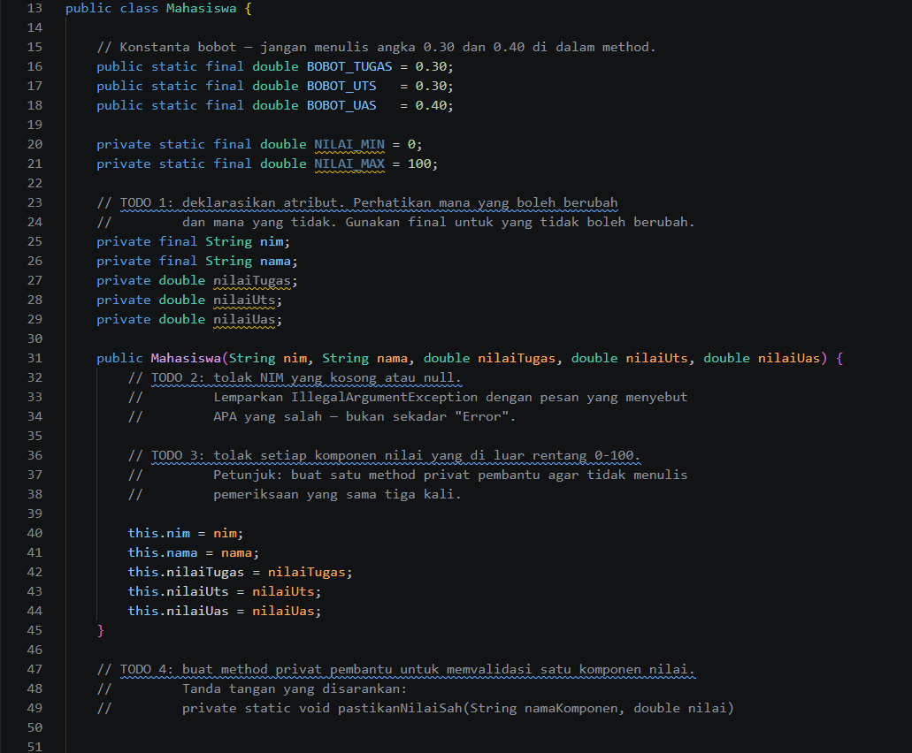

  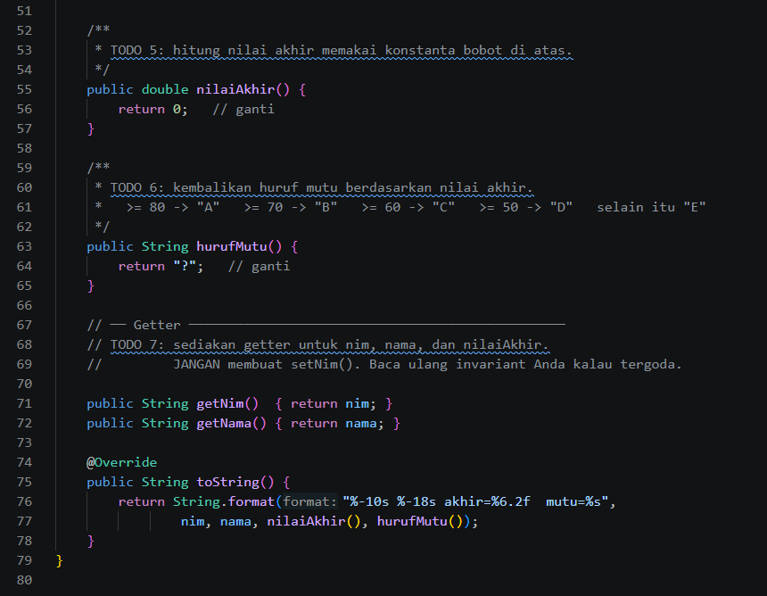

  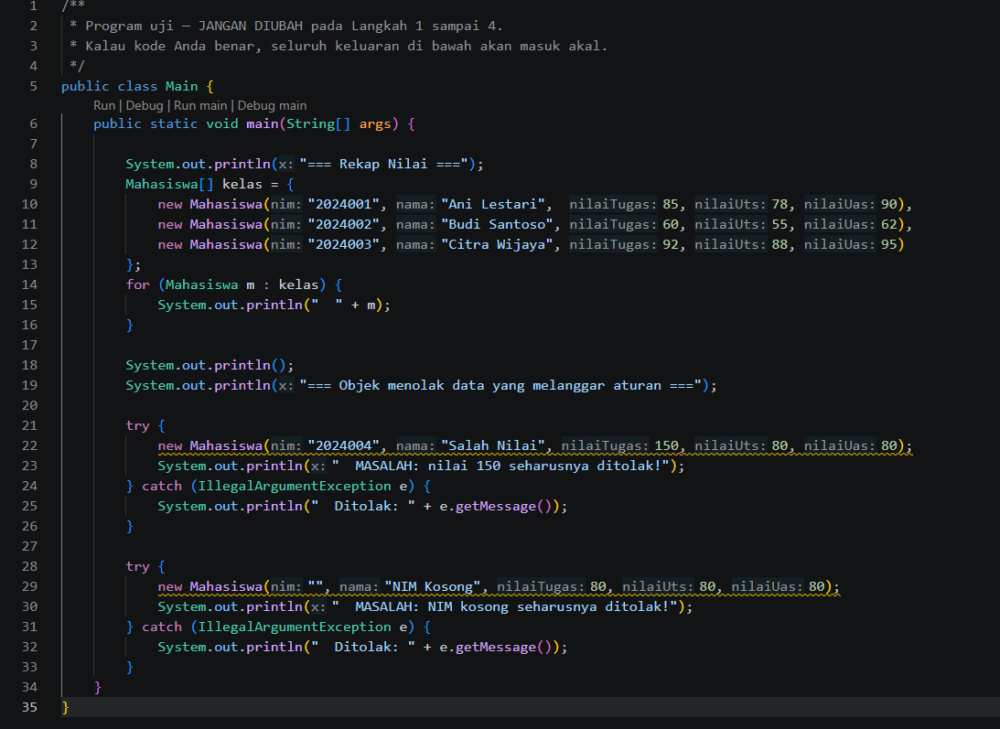

- **After** _(source setelah perubahan)_:

  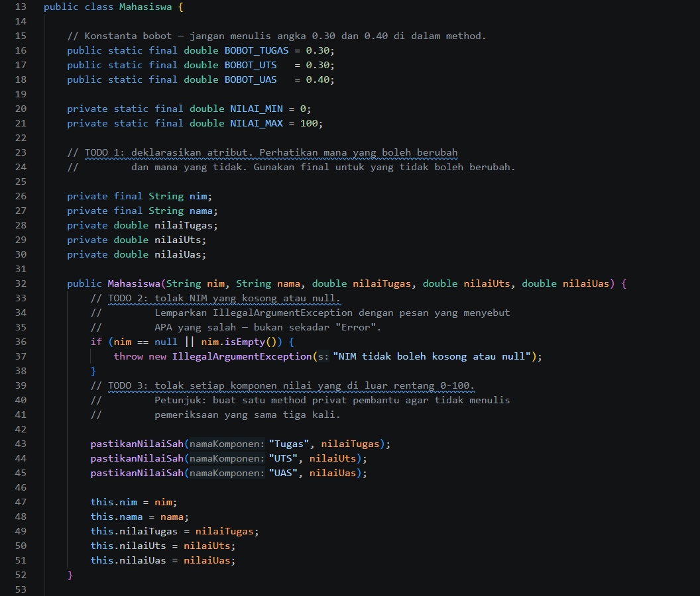

  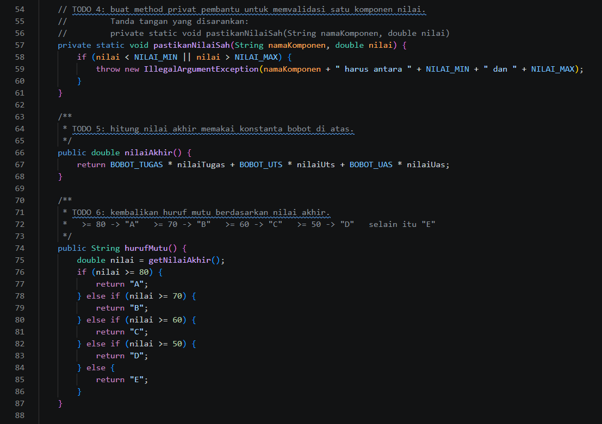

  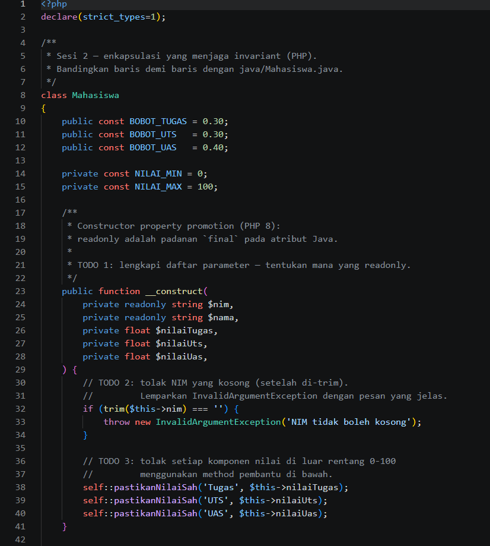

---

## PHP — `Mahasiswa.php`

**Penjelasan Kode:**

> **Before:** kelas PHP belum melengkapi perhitungan nilai dan validasi yang
> sama seperti implementasi Java.
>
> **After:** kelas menghitung nilai akhir berbobot, menentukan huruf mutu,
> serta memvalidasi identitas dan nilai agar data tidak valid ditolak.
> Source awal menggunakan typed class constants yang memerlukan PHP 8.3 atau
> lebih baru; pada PHP 8.2.12 versi awal tidak berhasil dijalankan.

**Bukti Eksekusi (Screenshot):**

- **Before** _(source awal)_:

  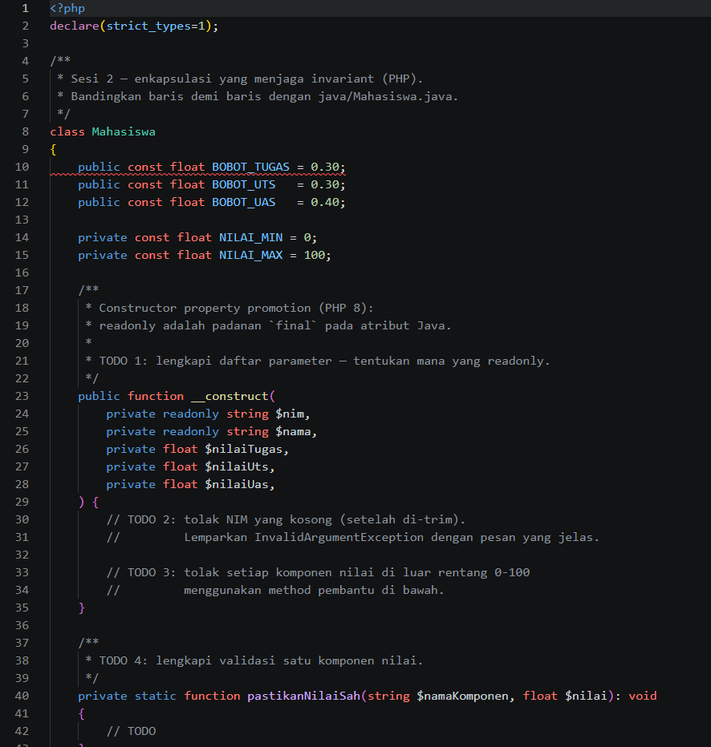

  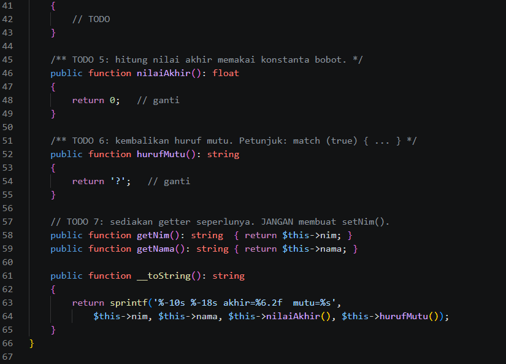

- **After** _(source setelah perubahan)_:

  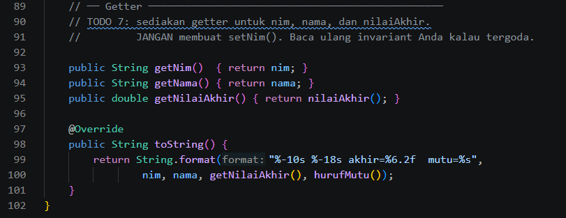

  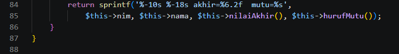

  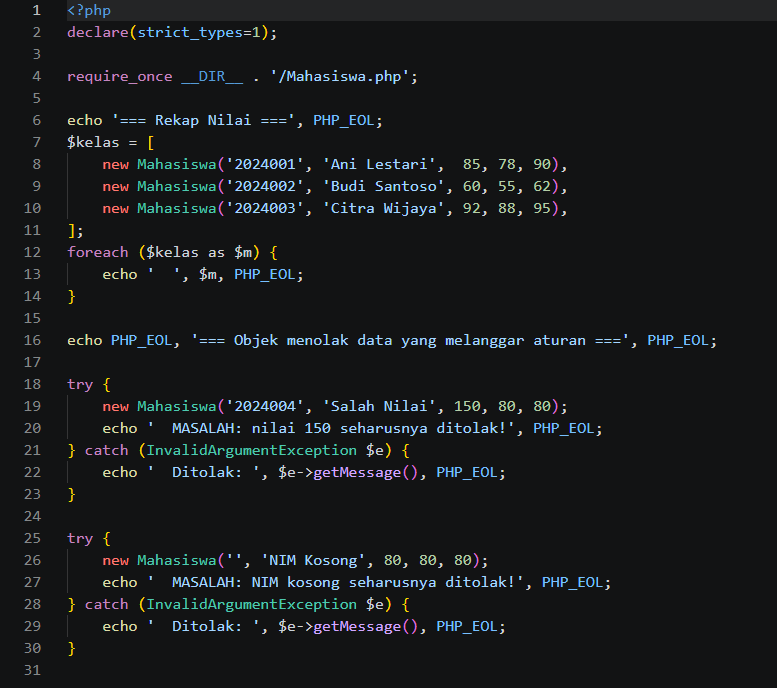

**Output Program:**

- **Before**:

  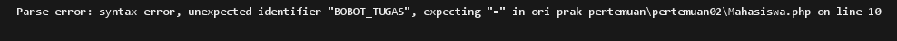

- **After**:

  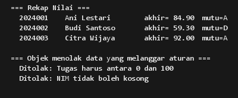

---

## Java — `App.java` dan program utama

**Penjelasan Kode:**

> `Mahasiswa` merupakan kelas model, bukan program mandiri. `App.java` dan
> `Main.java` digunakan sebagai program penguji yang membuat objek mahasiswa
> dan menampilkan hasil perilakunya. Screenshot kode yang tersedia
> memperlihatkan `App.java`.

**Bukti Eksekusi (Screenshot):**

- **After** _(program penguji)_:

  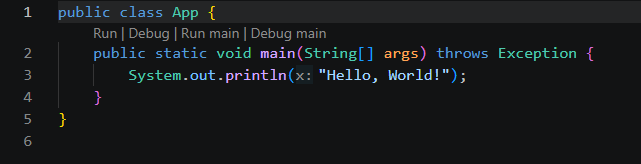

**Output Program:**

- **Before**:

  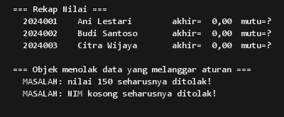

- **After**:

  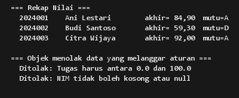

  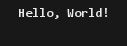

---

## PHP — `main.php`

**Penjelasan Kode:**

> `main.php` membuat dan menguji objek dari `Mahasiswa.php`. Sesudah kelas
> model dilengkapi, program utama menampilkan hasil perhitungan nilai dan
> memastikan input yang tidak sesuai aturan ditolak.

**Bukti Eksekusi (Screenshot):**

- **After** _(program utama)_:

  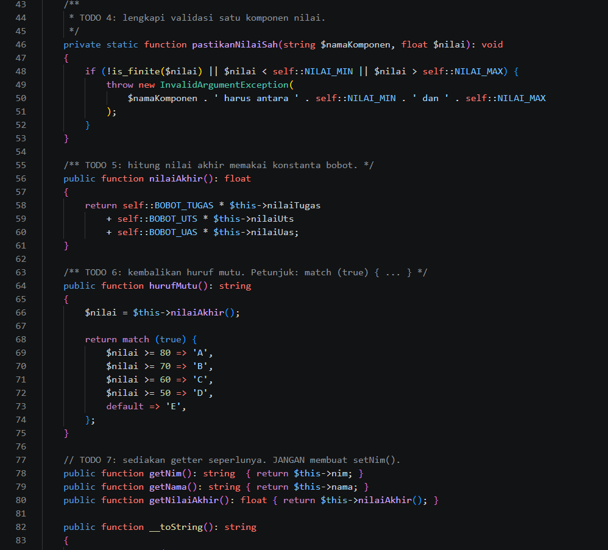

**Output Program:**

- **Before**:

  

- **After**:

  

---

## Hasil Pengujian

- Nilai akhir dihitung menggunakan bobot tugas 30%, UTS 30%, dan UAS 40%.
- Huruf mutu mengikuti batas A (minimal 80), B (70), C (60), D (50), dan E
  (di bawah 50).
- Nilai di luar rentang 0–100 dan NIM kosong ditolak.
- Output Java dan PHP setelah perubahan memperlihatkan hasil perhitungan dan
  penanganan data tidak valid.

## Catatan dan Kesimpulan

Kelas `Mahasiswa` menerapkan enkapsulasi dengan menjaga validitas data,
menghitung nilai akhir sesuai bobot, dan menentukan huruf mutu. Program utama
berfungsi sebagai driver untuk membuat objek dan menampilkan hasilnya.
