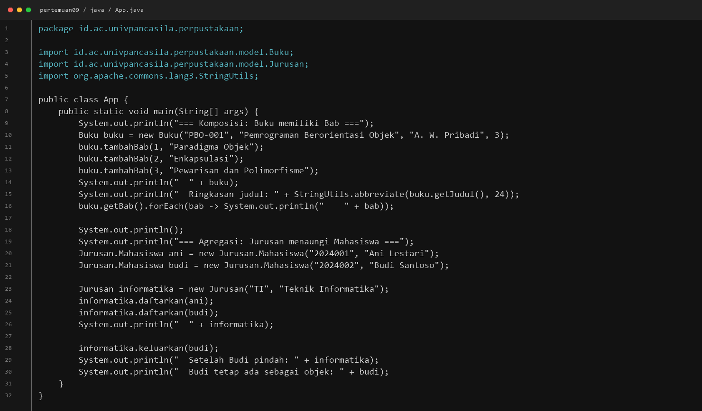
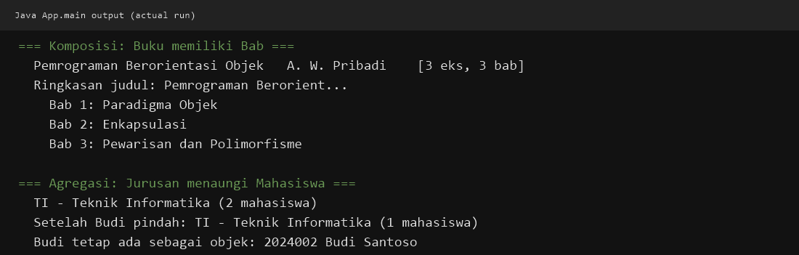
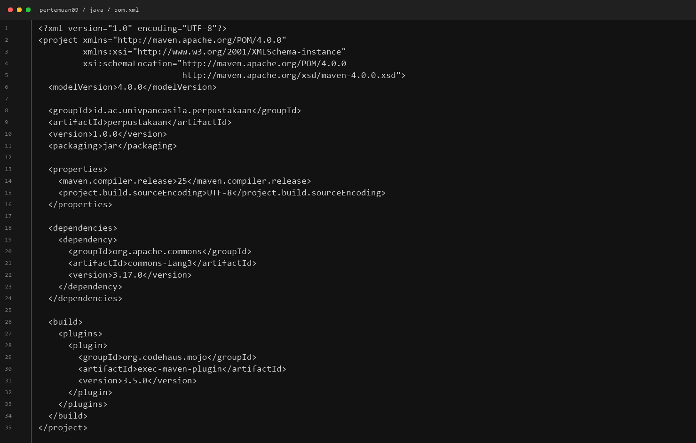
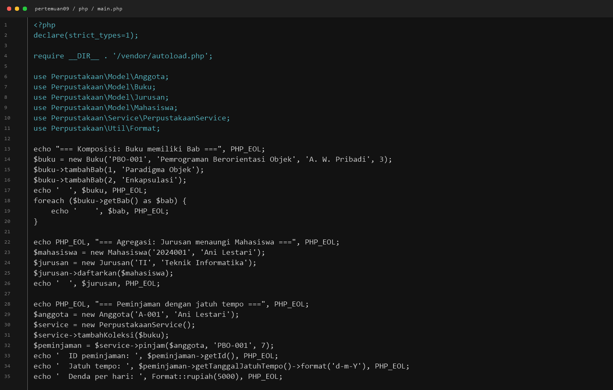
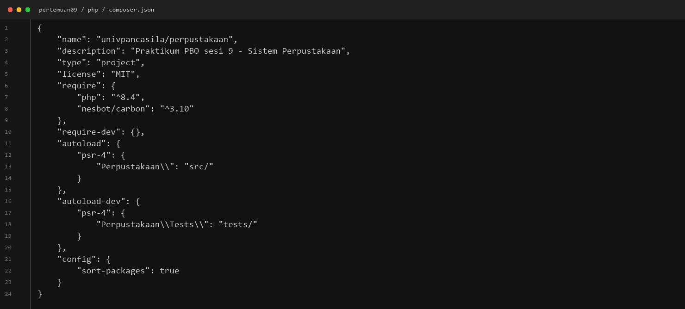
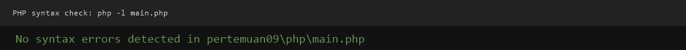

# LAPORAN PRAKTIKUM PEMROGRAMAN BERBASIS OBJEK

| Informasi Praktikan | Keterangan |
|---|---|
| **Nama** | Farid Zhahir Muttaqin |
| **NPM** | 4525210105 |
| **Kelas** | A |
| **Mata Kuliah** | Praktikum Pemrograman Berorientasi Objek (PBO) |
| **Pertemuan** | 09 — Package, Namespace, dan Build Tool |
| **Tanggal** | 29 Oktober 2026 |

---

## Java — `App.java`

**Penjelasan Kode:**

> Program utama berada di package `id.ac.univpancasila.perpustakaan`, sesuai
> lokasi file pada struktur Maven. `App.java` menjadi titik masuk karena
> memiliki method `main()`. Program mendemonstrasikan komposisi Buku–Bab dan
> agregasi Jurusan–Mahasiswa. Library Apache Commons Lang digunakan melalui
> `StringUtils.abbreviate()` untuk menyingkat judul buku.

**Bukti Eksekusi (Screenshot):**

- **Source `App.java`:**

  

**Output yang Diharapkan:**

Program menampilkan informasi buku beserta bab-babnya, ringkasan judul, daftar
mahasiswa pada Jurusan, lalu kondisi Jurusan setelah Budi dikeluarkan.

**Output Program:**



---

#
**Bukti Eksekusi (Screenshot):**

- **Konfigurasi Maven (`pom.xml`):**

  

**Perintah Membangun dan Menjalankan:**

```bash
cd pertemuan09/java
mvn clean compile
mvn exec:java -Dexec.mainClass=id.ac.univpancasila.perpustakaan.App
```

---

## PHP — `main.php`

**Penjelasan Kode:**

> `main.php` memuat `vendor/autoload.php`, kemudian menggunakan kelas-kelas
> dengan namespace `Perpustakaan\...` tanpa memanggil file kelas satu per satu.
> Program mendemonstrasikan komposisi Buku–Bab dan agregasi
> Jurusan–Mahasiswa. Program juga membuat peminjaman melalui
> `PerpustakaanService` dan menampilkan tanggal jatuh tempo yang dihitung
> menggunakan Carbon serta nominal denda melalui `Format::rupiah()`.

**Bukti Eksekusi (Screenshot):**

- **Source `main.php`:**

  

**Output yang Diharapkan:**

Program menampilkan informasi buku dan bab, mahasiswa pada Jurusan, ID
peminjaman, tanggal jatuh tempo, serta format nominal denda.

---

## PHP — `composer.json` dan Autoload PSR-4

**Penjelasan Kode:**

> `composer.json` mendefinisikan proyek `univpancasila/perpustakaan`, kebutuhan
> PHP `^8.4`, dependensi `nesbot/carbon`, serta pemetaan PSR-4 namespace
> `Perpustakaan\` ke direktori `src/`. Dengan pemetaan ini, Composer mencari
> kelas berdasarkan namespace dan lokasi file.
>
> Versi dependensi yang terpasang dikunci di `php/composer.lock` agar instalasi
> berikutnya menggunakan versi yang konsisten. Direktori `vendor/` dibuat oleh
> Composer dan tidak perlu disimpan di repositori.

**Bukti Eksekusi (Screenshot):**

- **Konfigurasi Composer (`composer.json`):**

  

**Perintah Memasang Dependensi dan Menjalankan:**

```bash
cd pertemuan09/php
composer install
php main.php
```

---

## Percobaan Package dan Namespace

**Penjelasan:**

> Percobaan mengubah deklarasi package atau namespace tanpa menyelaraskan
> struktur folder dan nama yang dipanggil membuat kelas gagal ditemukan atau
> dikompilasi. Catatan berisi pesan kesalahan serta langkah perbaikannya ada di
> [`percobaan.md`](../percobaan.md).


---

## Hasil Pengujian

- [`dependency-tree.txt`](../dependency-tree.txt) mencatat dependensi Java
  `org.apache.commons:commons-lang3:3.17.0`.
- [`percobaan.md`](../percobaan.md) mencatat kesalahan package/namespace yang
  tidak cocok beserta perbaikannya.
- Program Java berhasil dijalankan; output aktualnya terlihat pada screenshot
  di atas.
- Pemeriksaan sintaks `php -l main.php` berhasil. Screenshot hasil pemeriksaan:

  
- Eksekusi ulang saat penyusunan laporan belum berhasil diverifikasi di
  lingkungan ini: Maven tidak tersedia, sedangkan PHP yang terpasang adalah
  8.2.12 (proyek mensyaratkan PHP 8.4+) dan `php/vendor/autoload.php` belum ada.
- Untuk verifikasi, gunakan Java 25 dan Maven serta PHP 8.4+ dan Composer, lalu
  jalankan perintah pada bagian masing-masing.