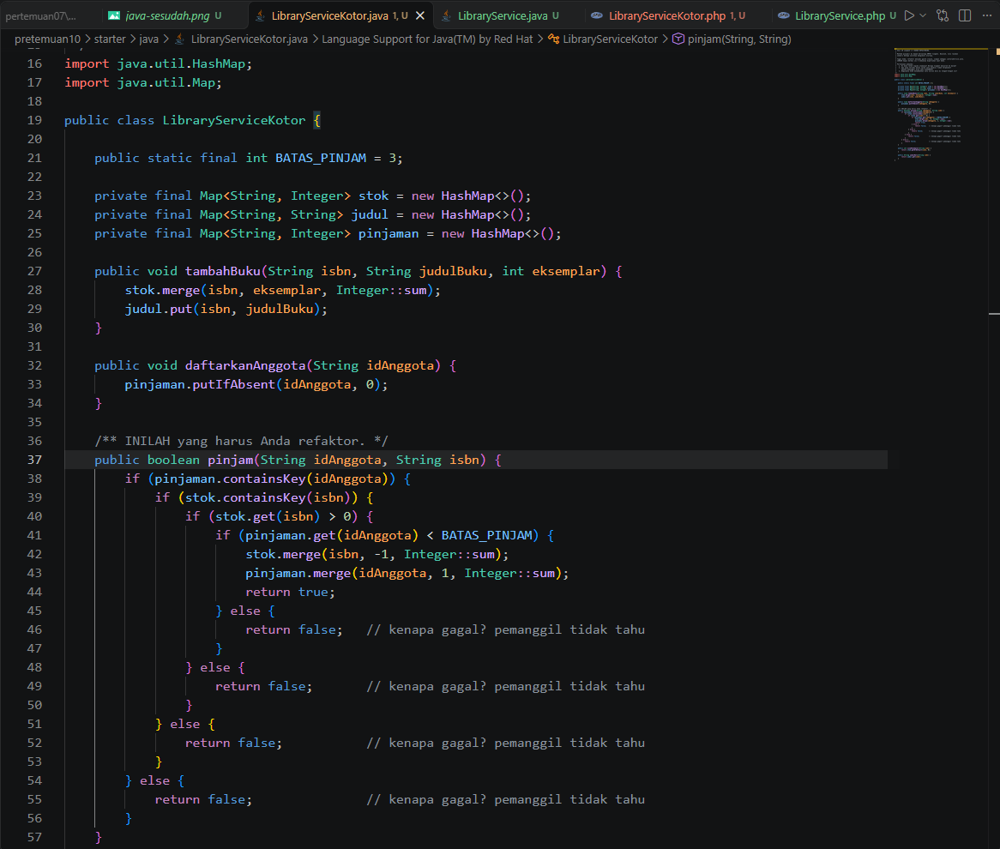
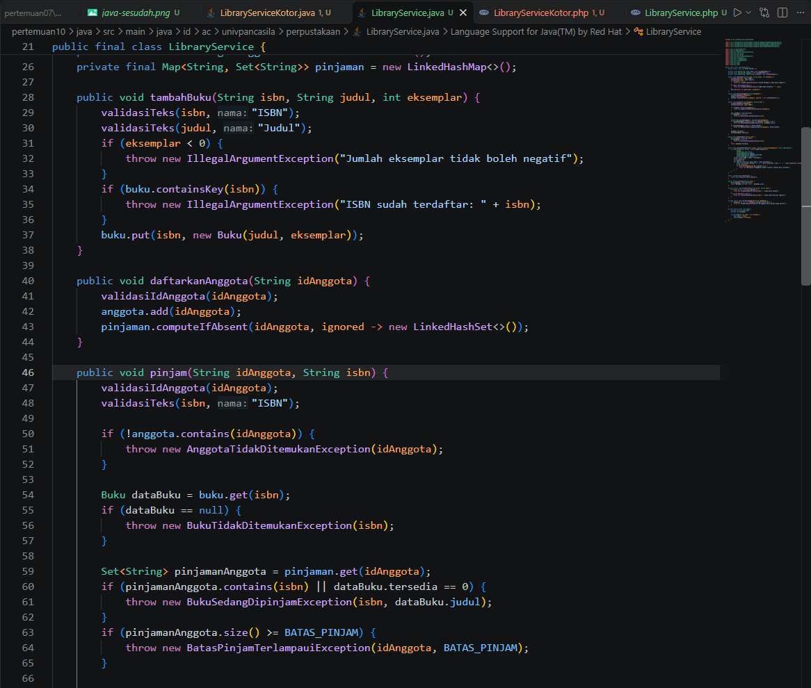
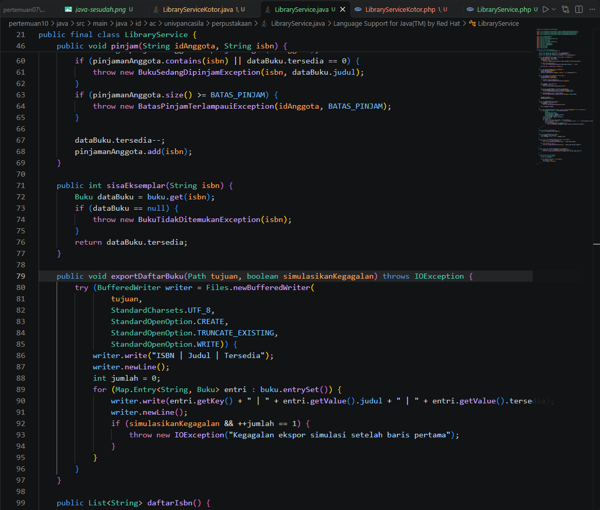
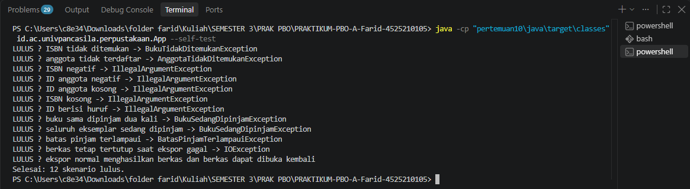
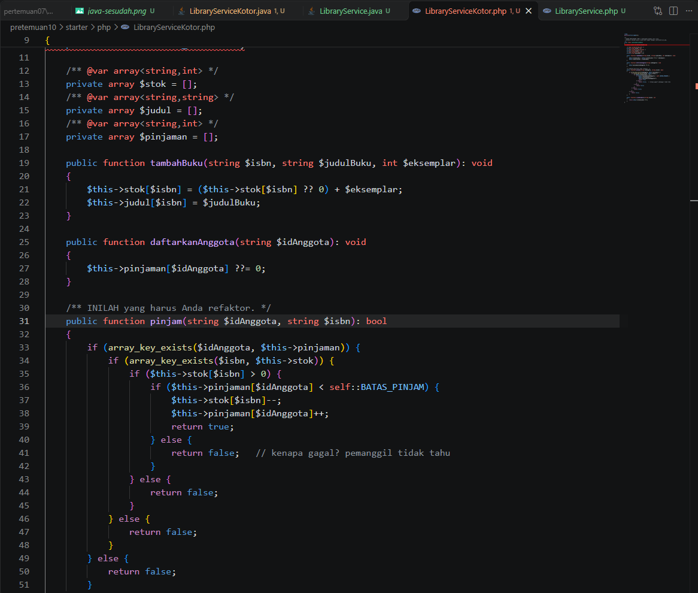
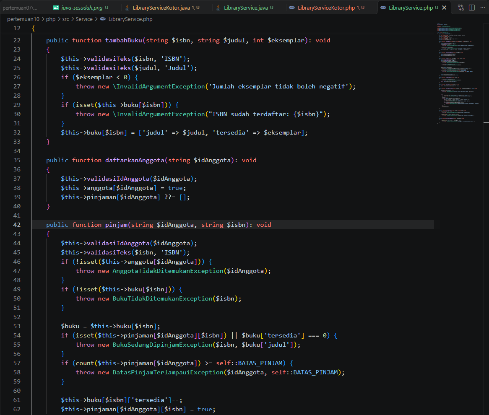
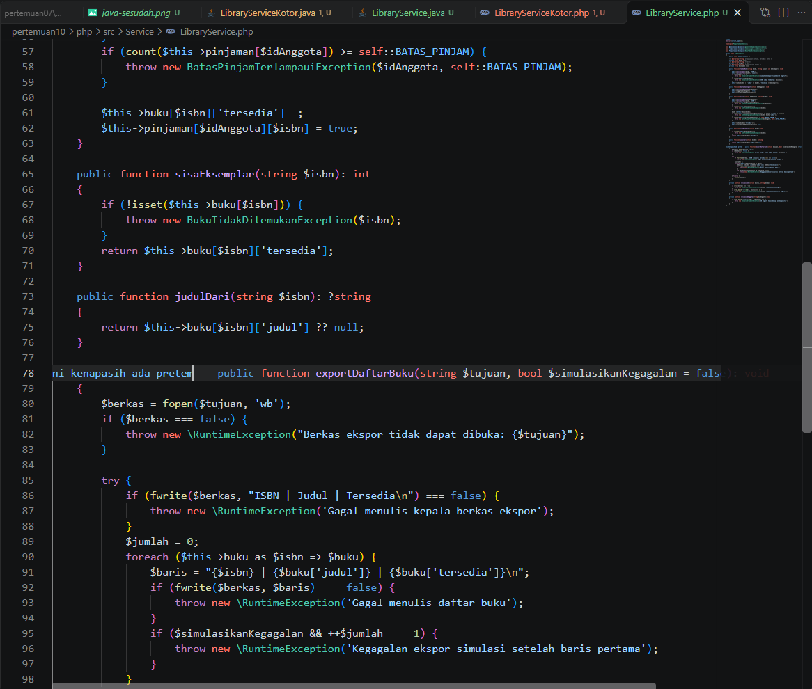

# LAPORAN PRAKTIKUM PEMROGRAMAN BERBASIS OBJEK

| Informasi Praktikan | Keterangan |
|---|---|
| **Nama** | Farid Zhahir Muttaqin |
| **NPM** | 4525210105 |
| **Kelas** | A |
| **Mata Kuliah** | Praktikum Pemrograman Berorientasi Objek (PBO) |
| **Pertemuan** | 10 — Exception Handling dan Pemrograman Defensif |
| **Tanggal** | 9 November 2026 |

---

## Java — `LibraryService`

**Penjelasan Kode:**

> **Before:** `pinjam()` pada starter memakai empat tingkat `if`. Jika
> peminjaman gagal, method hanya mengembalikan `false`; pemanggil tidak tahu
> apakah penyebabnya anggota tidak terdaftar, ISBN tidak ditemukan, stok habis,
> atau batas peminjaman tercapai.
>
> **After:** method memvalidasi masukan dan memeriksa setiap kondisi sebelum
> mengubah stok. Kegagalan menghasilkan exception domain yang sesuai dan
> membawa data penyebabnya. Dengan begitu, pemanggil bisa menampilkan pesan
> yang jelas dan mencatat kegagalan tanpa menebak dari nilai boolean. Karena
> perubahan stok dilakukan setelah seluruh pemeriksaan, peminjaman yang ditolak
> tidak mengubah data.

**Bukti Source (Screenshot):**

- **Before** _(starter asli)_: `pinjam()` bersarang dan mengembalikan `false`.

  

- **After** _(hasil refactoring)_: guard clause melempar exception spesifik.

  

**Source:**

- [Sebelum — `LibraryServiceKotor.java`](<../../ori prak pertemuan/pretemuan10/starter/java/LibraryServiceKotor.java>)
- [Sesudah — `LibraryService.java`](../java/src/main/java/id/ac/univpancasila/perpustakaan/LibraryService.java)

## Java — custom exception dan penanganan masukan

**Penjelasan Kode:**

> **Before:** exception domain pada starter masih berisi TODO, sehingga belum
> dapat menjelaskan jenis kegagalan atau menyimpan data terkait.
>
> **After:** exception domain membawa data yang diperlukan—misalnya ISBN,
> ID anggota, judul buku, atau batas pinjaman. `App` menangani exception
> perpustakaan pada batas interaksi, menampilkan pesannya, dan mencatat
> detailnya. Masukan ID dan ISBN yang kosong, negatif, atau bukan angka yang
> valid ditolak sebelum operasi dijalankan. Pemisahan ini mencegah masukan
> pengguna yang salah merusak data atau menghentikan alur menu.

Exception domain diturunkan dari `PerpustakaanException`. Kesalahan masukan
ditangani sebagai `IllegalArgumentException`, sedangkan kegagalan ekspor
ditangani sebagai `IOException`.

**Source:**

- [Sebelum — starter Java](<../../ori prak pertemuan/pretemuan10/starter/java/exception/>)
- [Sesudah — custom exception Java](../java/src/main/java/id/ac/univpancasila/perpustakaan/exception/)
- [Menu dan penanganan masukan — `App.java`](../java/src/main/java/id/ac/univpancasila/perpustakaan/App.java)
- [Pencatatan exception — `ExceptionLogger.java`](../java/src/main/java/id/ac/univpancasila/perpustakaan/ExceptionLogger.java)

## Java — ekspor dan hasil pengujian

**Penjelasan Kode:**

> Starter belum menyediakan ekspor daftar buku. Fitur ini ditambahkan
> menggunakan `try-with-resources`, sehingga writer selalu ditutup, termasuk
> saat penulisan melempar `IOException`. Penutupan ini penting agar berkas
> tidak tertinggal dalam keadaan terbuka dan dapat dipindah atau dihapus
> sesudah kegagalan.

**Bukti Source dan Eksekusi (Screenshot):**



Self-test menjalankan sepuluh skenario kegagalan, ekspor gagal, dan ekspor
berhasil. Seluruh 12 skenario lulus:



---

## PHP — `LibraryService`

**Penjelasan Kode:**

> **Before:** `pinjam()` pada starter juga memakai empat tingkat `if` dan
> mengembalikan `false` untuk semua kegagalan. Pemanggil tidak bisa mengetahui
> penyebab peminjaman ditolak.
>
> **After:** pemeriksaan dilakukan berurutan menggunakan guard clause.
> Kegagalan melempar exception domain yang sesuai, dan stok serta catatan
> pinjaman baru diubah setelah seluruh syarat terpenuhi. Hasilnya, alasan
> kegagalan dapat ditangani dan dicatat dengan jelas tanpa mengubah state pada
> peminjaman yang tidak berhasil.

**Bukti Source (Screenshot):**

- **Before** _(starter asli)_: kondisi bertingkat dan hasil `false`.

  

- **After** _(hasil refactoring)_: guard clause dan exception domain.

  

**Source:**

- [Sebelum — `LibraryServiceKotor.php`](<../../ori prak pertemuan/pretemuan10/starter/php/LibraryServiceKotor.php>)
- [Sebelum — kerangka exception PHP](<../../ori prak pertemuan/pretemuan10/starter/php/exceptions.php>)
- [Sesudah — `LibraryService.php`](../php/src/Service/LibraryService.php)
- [Sesudah — custom exception PHP](../php/src/Exception/)
- [Pencatatan exception — `ExceptionLogger.php`](../php/src/Util/ExceptionLogger.php)

## PHP — ekspor dan hasil pengujian

**Penjelasan Kode:**

> Starter PHP belum menyediakan ekspor. Fitur yang ditambahkan memakai
> `try/finally` untuk memastikan `fclose()` tetap dijalankan jika penulisan
> gagal. PHP dan Java memakai sintaks pengelolaan sumber daya yang berbeda,
> tetapi keduanya memastikan berkas ditutup ketika operasi gagal.

**Bukti Source (Screenshot):**



Self-test PHP belum dapat dijalankan di lingkungan ini. Versi PHP yang tersedia
adalah 8.2.12, sedangkan proyek mensyaratkan PHP `^8.4`; selain itu Composer
dan `vendor/autoload.php` tidak tersedia. File PHP berhasil melewati
pemeriksaan sintaks `php -l`, tetapi itu bukan pengganti pengujian runtime.

---

## Perintah Verifikasi

Jalankan Java dari direktori `pertemuan10/java` dan PHP dari direktori
`pertemuan10/php`:

```powershell
# Java
mvn clean compile
mvn exec:java -Dexec.mainClass=id.ac.univpancasila.perpustakaan.App -Dexec.args="--self-test"

# PHP
composer install
php main.php --self-test
```

## Hasil Pengujian

- Source Java dikompilasi dengan target `--release 25`; 12 skenario self-test
  lulus.
- Seluruh file PHP lolos pemeriksaan sintaks `php -l`.
- Self-test runtime PHP belum dapat dijalankan karena versi PHP dan Composer
  yang dibutuhkan tidak tersedia.
