# Laporan Praktikum PBO — Pertemuan 11

## Collections, Generics, dan Unit Test Pertama

### Identitas

- Nama: Farid Zhahir Muttaqin
- NPM: 4525210105
- Kelas: A
- Mata Kuliah: Praktikum Pemrograman Berorientasi Objek
- Pertemuan: 11
- Tanggal: 114 November 2026

## Kondisi sebelum perubahan

Source starter yang disediakan di folder `starter` masih memiliki TODO. Pada
Java, operasi simpan, cari, daftar tak dapat diubah, dan hapus pada
`Repository<T>` belum diimplementasikan; lima tes awal juga masih berhenti
pada `fail("TODO ... belum dikerjakan")`. Pada PHP, operasi pada `KoleksiBuku`
masih mengembalikan nilai placeholder dan kelima tes awal masih berisi TODO.

Starter hanya menyediakan kerangka repository/koleksi dan test; belum ada
program demo perpustakaan yang dapat dijalankan. Karena itu bukti running
sebelum perubahan adalah hasil tes starter, bukan output aplikasi.

### Source Java sebelum perubahan

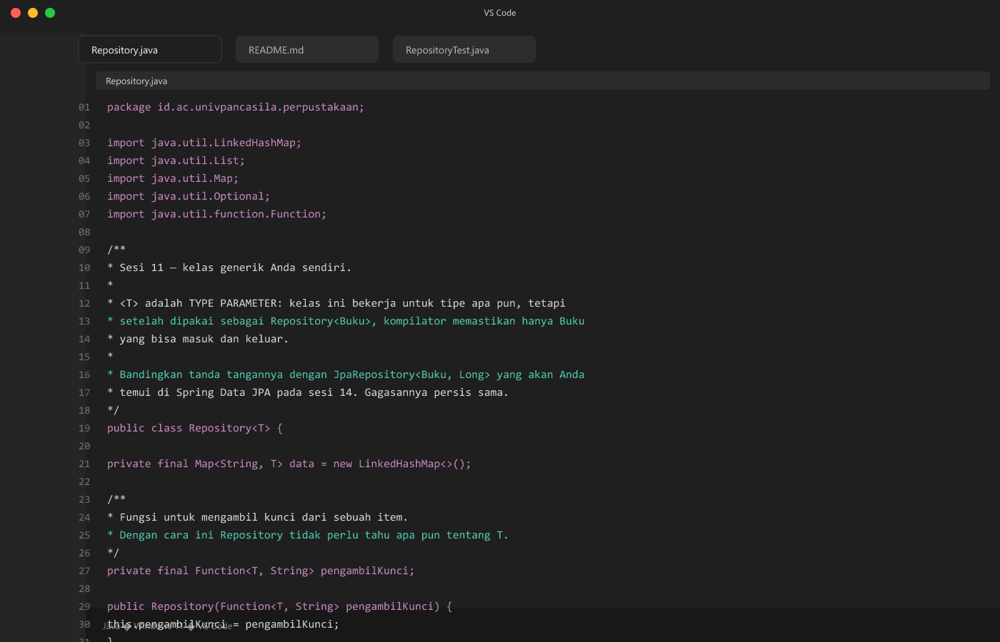

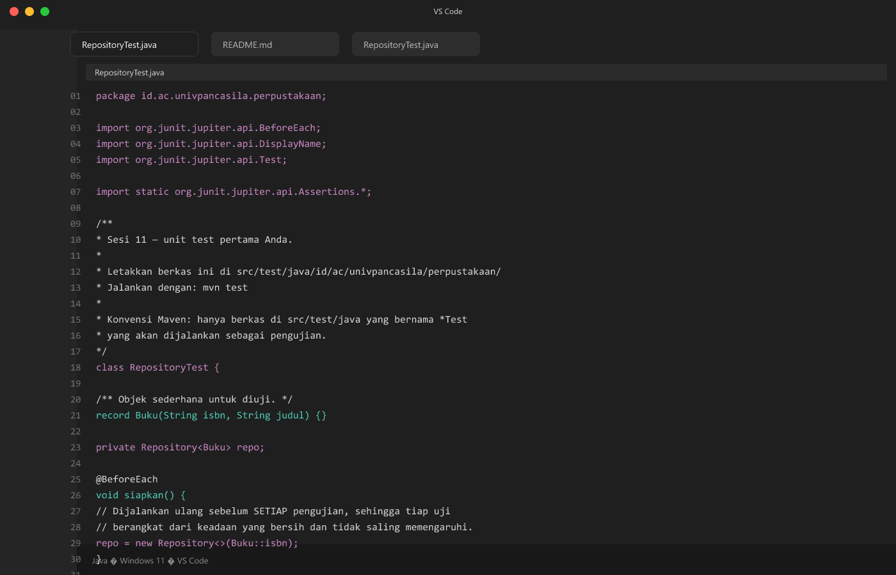

### Source PHP sebelum perubahan

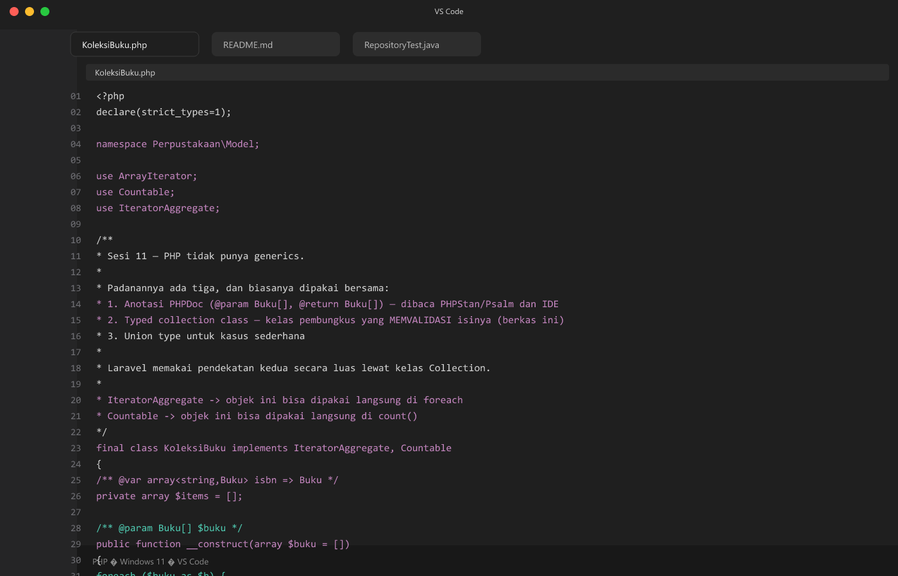

### Hasil tes sebelum perubahan

Kelima tes starter Java dan kelima tes starter PHP gagal sebagaimana
diharapkan, karena source dan test skeleton masih berisi TODO.

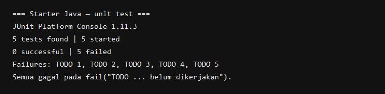

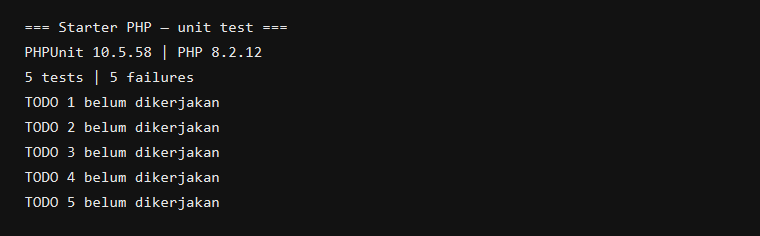

## Perubahan yang dilakukan

1. Melengkapi `Repository<T>` Java menggunakan `LinkedHashMap`, fungsi
   pengambil kunci, `Optional<T>` untuk pencarian, `List.copyOf(...)` untuk
   daftar yang tak dapat diubah, dan status boolean untuk penghapusan.
2. Melengkapi `KoleksiBuku` PHP sebagai typed collection yang menyediakan
   simpan, cari, filter, map, penjumlahan, pengelompokan, iterasi, dan hitung.
3. Menambahkan model `Buku` serta `LibraryService` di Java dan PHP untuk
   mengelola koleksi, anggota, laporan buku, stok, dan peminjaman.
4. Menambahkan demo yang menampilkan buku tersedia, daftar judul, jumlah
   judul per penulis, perubahan stok setelah peminjaman, serta pencarian
   melalui repository generik Java.
5. Mengisi unit test operasi repository/koleksi dan skenario layanan, termasuk
   pencarian yang tidak ditemukan, koleksi tak dapat diubah di Java, exception
   domain, peminjaman ganda, dan batas tiga buku.

## Source setelah perubahan

### Java

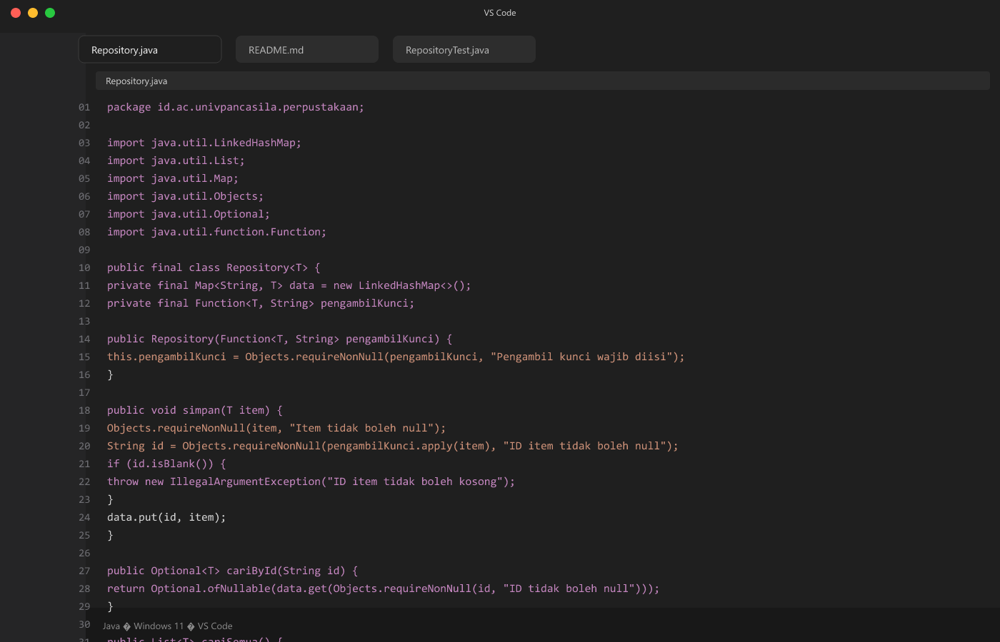

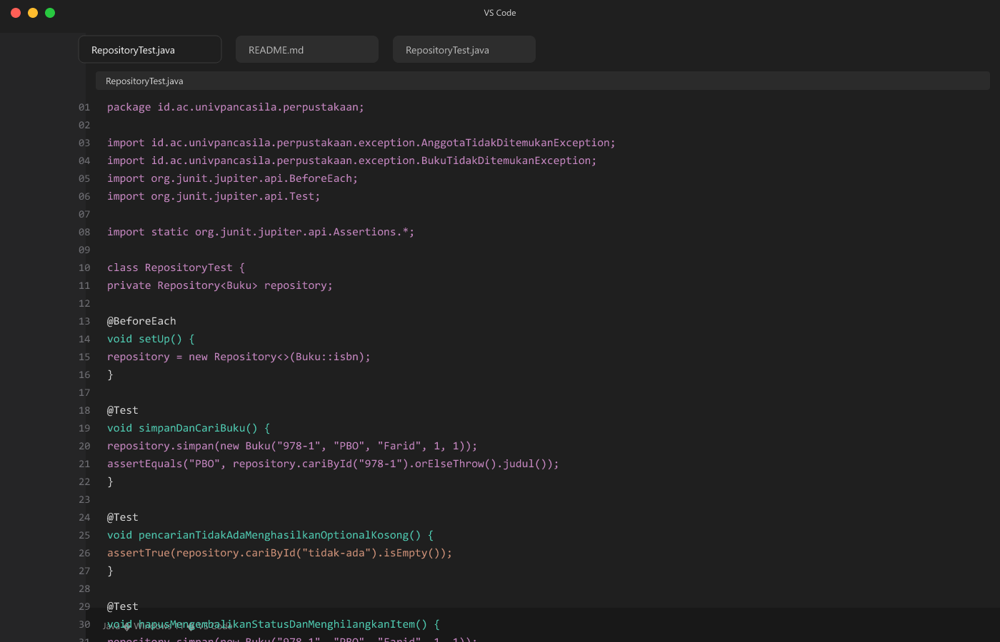

### PHP

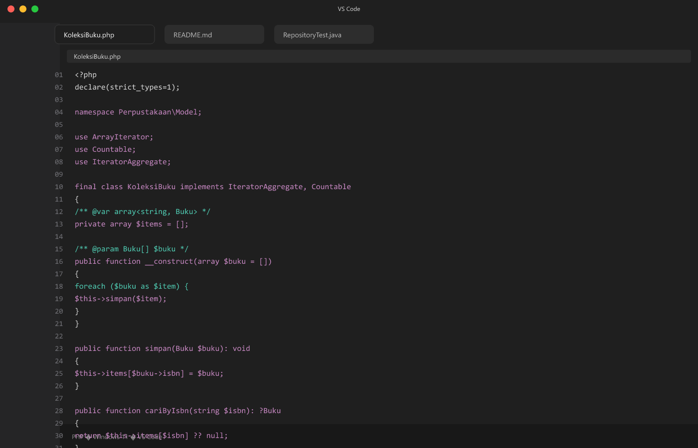

## Hasil running dan pengujian setelah perubahan

Kedua demo berhasil dijalankan. Keduanya menampilkan dua buku yang tersedia,
seluruh judul, pengelompokan berdasarkan penulis, dan sisa satu eksemplar
setelah peminjaman. Unit test Java lulus **12/12**, sedangkan PHPUnit lulus
**12 tes dengan 15 assertion**.

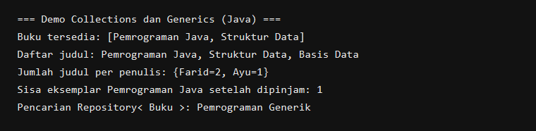

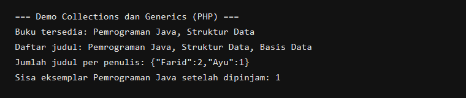

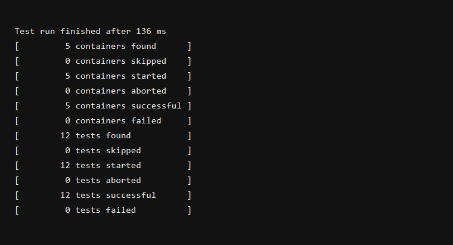

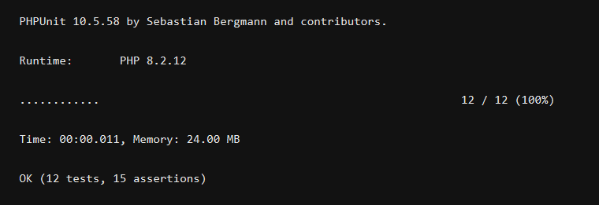

### Lingkungan verifikasi

- Java: source dan tes dikompilasi dengan `javac --release 25`; 12 tes
  dijalankan menggunakan JUnit Platform Console Standalone 1.11.3. Maven
  tidak tersedia pada PATH di lingkungan ini.
- PHP: PHP 8.2.12 dan PHPUnit 10.5.58; 12 tes lulus dengan 15 assertion.
- Seluruh file PHP dalam project lolos `php -l`.

Perincian pilihan struktur koleksi dan null-safety ada di
[pilihan-koleksi.md](../sesi-11/pilihan-koleksi.md). Refleksi mengenai kasus
uji tersulit ada di [catatan-uji.md](../sesi-11/catatan-uji.md).
